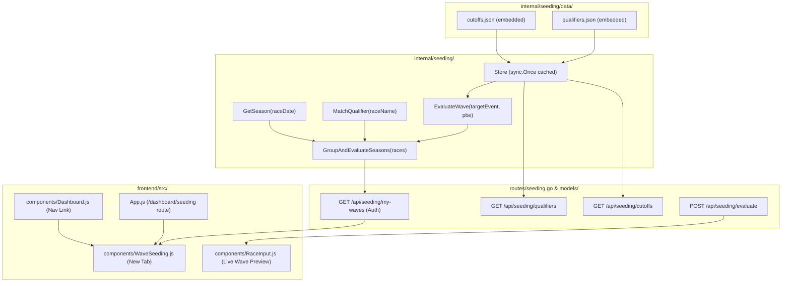

# Implementation Plan: Stored Races Wave Seeding & Season Qualifications

## Goal Description
Enhance the existing Go-based percent back race tracker on [nordicracetrack.com](https://nordicracetrack.com) by calculating and displaying wave seeding qualifications directly from users' stored race results.

Instead of calculating target times, this system leverages the `PercentBack`, `RaceDate`, and `RaceName` already stored in MongoDB to:
1. Automatically group races into standard Nordic ski seasons (July 1 to June 30 of the following year, e.g. races in Jan 2024 belong to the `2023-2024` season).
2. Evaluate each race and qualifier adjustment across all 4 Birkie events:
   - **American Birkebeiner Skate (50K)** (Waves 1–8)
   - **American Birkebeiner Classic (53K)** (Waves 1–5)
   - **Kortelopet Skate (29K)** (Waves 1–3)
   - **Kortelopet Classic (29K)** (Waves 1–3)
3. Determine the user's best qualified wave per event for each season.
4. Present a dedicated, mobile-friendly **"Wave Seeding"** tab in the Dashboard displaying:
   - Current season overview cards showing best qualified waves for all 4 events.
   - Season-by-season breakdown with race-level qualification badges, matched qualifiers, and PBE (Percent Back Equivalent).
   - Live wave qualification preview in the Race Input form.

---

## User Review Required
> [!IMPORTANT]
> **Key Decisions:**
> 1. **Unit tests skipped:** Per user preference, unit test creation (`_test.go`) is skipped to align with existing repo conventions. Verification will focus on build integrity (`go build ./...`) and runtime validation.
> 2. **Dedicated Wave Seeding Tab:** Added to the Dashboard (`/dashboard/seeding`) alongside Input, Table, and Chart.
> 3. **4-Event Evaluation:** Evaluates Birkie Skate, Birkie Classic, Korte Skate, and Korte Classic simultaneously.
> 4. **Ski Season Boundaries:** Standard Nordic ski season (July 1 – June 30).
> 5. **Qualifier Auto-Matching:** Automatic matching of known qualifiers (Seeley, Mora, Noquemanon, City of Lakes, Pre-Birkie, Great Bear Chase) based on race name, with fallback to raw percent back.

> [!NOTE]
> All existing database collections, user authentication, race creation, deletion, and baseline calculations remain intact and 100% backwards-compatible.

---

## Open Questions
- None.

---

## Proposed Changes



---

### Component 1: Embedded Static JSON Data Layer

#### [NEW] `internal/seeding/data/cutoffs.json`
Static cutoffs defining wave brackets for all 4 events:
- `birkie_skate` (Waves 1 to 8: 38.0%, 49.5%, 59.0%, 69.5%, 82.5%, 100.0%, 125.0%, 180.0%)
- `birkie_classic` (Waves 1 to 5: 50.5%, 72.0%, 95.0%, 127.0%, 170.0%)
- `korte_skate` (Waves 1 to 3: 60.0%, 82.5%, 115.0%)
- `korte_classic` (Waves 1 to 3: 85.5%, 106.5%, 140.0%)

#### [NEW] `internal/seeding/data/qualifiers.json`
Static list of recognized qualifier races and adjustment percentages (Seeley 0%, Mora +5%, Noquemanon +3%, City of Lakes +2%, Pre-Birkie 0%, Great Bear Chase +4%, etc.).

---

### Component 2: Seeding Domain Logic

#### [NEW] `internal/seeding/seeding.go`
- `//go:embed` loading of `cutoffs.json` and `qualifiers.json`.
- Types:
  - `WaveBracket`: `Wave int`, `MinPBE float64`, `MaxPBE float64`.
  - `Qualifier`: `ID string`, `Name string`, `Adjustment float64`, `Keywords []string`.
  - `EventQualification`:
    - `EventID string` (e.g., `birkie_skate`)
    - `EventName string` (e.g., `Birkie Skate 50K`)
    - `PBE float64`
    - `QualifiedWave int`
    - `QualifiedWaveLabel string` (e.g. `Wave 2`)
    - `DistanceToNext float64` (percentage points from `QualifiedWave - 1`)
  - `RaceSeeding`:
    - `RaceID string`, `RaceName string`, `RaceDate string`, `RaceDistance float64`, `PercentBack float64`
    - `MatchedQualifier Qualifier`
    - `Qualifications map[string]EventQualification`
  - `SeasonSummary`:
    - `Season string` (e.g., `2023-2024`)
    - `BestWaves map[string]int` (best wave for Birkie Skate, Birkie Classic, Korte Skate, Korte Classic)
    - `Races []RaceSeeding`
- Helper Functions:
  - `GetSeason(dateStr string) string`: Splits date at July 1 boundary.
  - `MatchQualifier(raceName string) Qualifier`: Matches names with keyword matching (e.g. "mora", "seeley", "noque", "loppet", "bear chase").
  - `EvaluateWave(eventKey string, pbe float64) (int, float64)`: Matches PBE to wave cutoff.
  - `GroupAndEvaluateSeasons(races []models.Race) []SeasonSummary`: Processes a user's race history into ordered seasons with best wave achievements.

---

### Component 3: Backend API Routes & Models

#### [MODIFY] `models/races.go`
Add seeding view models and types for JSON serialization.

#### [NEW] `routes/seeding.go`
- `GET /api/seeding/my-waves` (authenticated via `authMiddleware`):
  - Queries `races` collection for the authenticated user ID.
  - Invokes `seeding.GroupAndEvaluateSeasons(races)`.
  - Returns JSON array of `SeasonSummary` objects.
- `GET /api/seeding/qualifiers`: Returns static qualifiers list.
- `GET /api/seeding/cutoffs`: Returns static cutoffs.
- `POST /api/seeding/evaluate`: Evaluates ad-hoc percent back and qualifier for live preview in race creation.

#### [MODIFY] `routes/server.go`
Register `seedingRoutes(api, client)` in the Gin router.

---

### Component 4: Frontend UI (Mobile-First React)

#### [NEW] `frontend/src/components/WaveSeeding.js`
A dedicated, responsive dashboard view featuring:
1. **Current Season Banner Cards:**
   - 4 summary cards (Birkie Skate, Birkie Classic, Korte Skate, Korte Classic) with prominent wave badges (e.g. "Wave 1", "Wave 2") and the race that qualified the user.
2. **Season Breakdown (Accordion / Card List):**
   - Each ski season (e.g. 2024-2025, 2023-2024) expandable.
   - Shows best wave achieved per event in that season.
   - Detailed table of races in that season:
     - Race Name & Date
     - Stored % Back & Matched Qualifier adjustment
     - Wave chips for all 4 events with color coding (Gold for Wave 1, Blue for Wave 2/3, Gray for other waves).
3. **Empty State:** Clean message if no races are logged yet with a button directing to "Add Race".

#### [MODIFY] `frontend/src/components/RaceInput.js`
- As the user types their race time and first place time:
  - Immediately displays a live preview card showing which wave the new race would qualify them for across the 4 events.

#### [MODIFY] `frontend/src/components/Dashboard.js`
- Add "Wave Seeding" navigation button in the top AppBar.

#### [MODIFY] `frontend/src/App.js`
- Register the `/dashboard/seeding` route inside the authenticated `<Dashboard />` route group.

---

## Verification Plan

### Automated Build Verification
1. **Full Go Backend Build:**
   ```bash
   go build ./...
   ```
2. **Frontend Build Verification:**
   ```bash
   cd frontend && npm run build
   ```

### Manual Verification
1. Log in to the application and navigate to the new **"Wave Seeding"** tab.
2. Verify that existing races in MongoDB appear grouped under their respective ski seasons (e.g. `2023-2024`).
3. Verify that wave qualification badges display accurately for Birkie Skate, Birkie Classic, Korte Skate, and Korte Classic according to cutoff brackets.
4. Verify that races with qualifier names (e.g. "Mora Vasaloppet" or "Seeley Hills") apply the corresponding adjustments.
5. In **Race Input**, enter a new race time and verify the real-time wave qualification preview card updates dynamically.
